# UML — dominio y puertos

Fuente canónica de los diagramas del [software design](software-design.md).
Los PRs que añaden un tipo de dominio o un puerto **actualizan este archivo**
(o fallan el criterio de aceptación del issue).

Convención: cada diagrama tiene un ancla (`{#id}`). Los issues citan
`docs/uml.md#id`.

## Dominio actual — aggregate `Candidate` {#candidate-now}

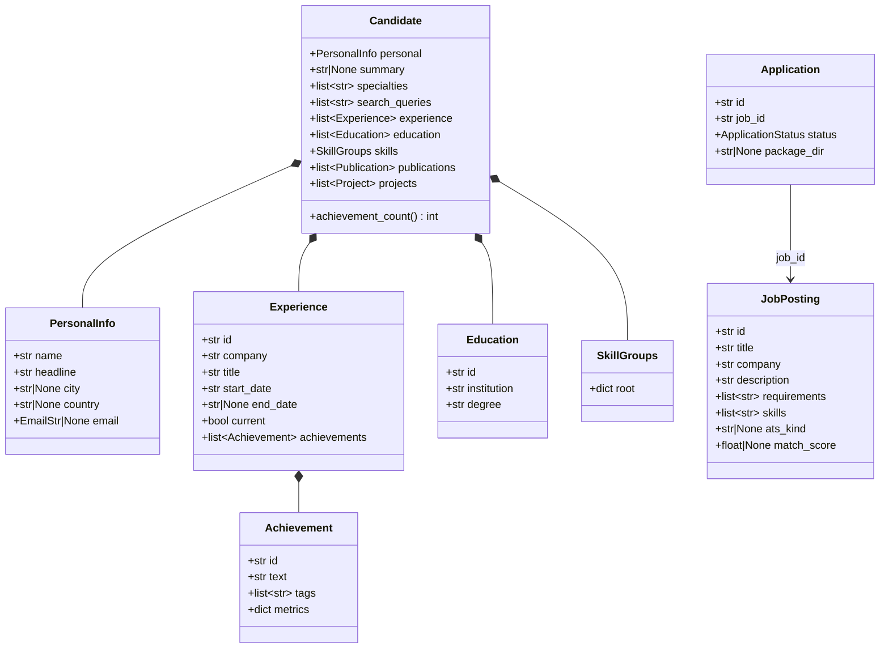

## Target — hechos vs preferencias + evidencia {#fact-preference}

Patrones: **Aggregate Root**, **Value Object**, asociación skills↔roles.
Issues: #141 #144 #185 #195 #206 #221.

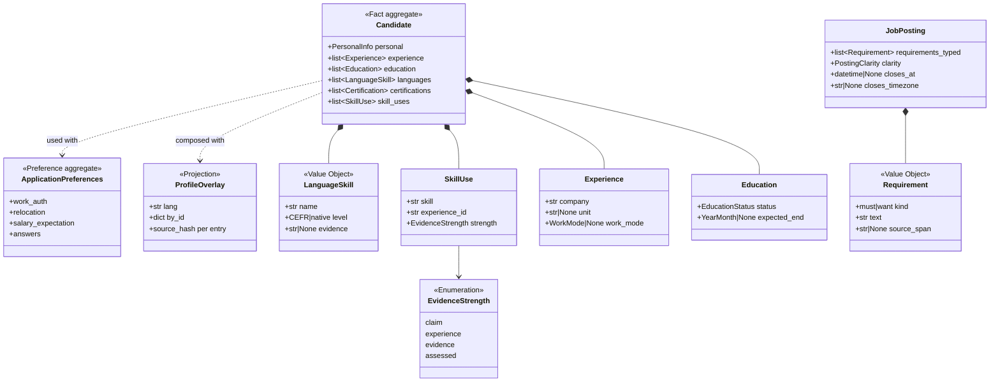

## Puertos y adapters (hexagonal) {#ports}

Patrones: **Port/Adapter**, **Factory**, **Strategy**, **Registry**.

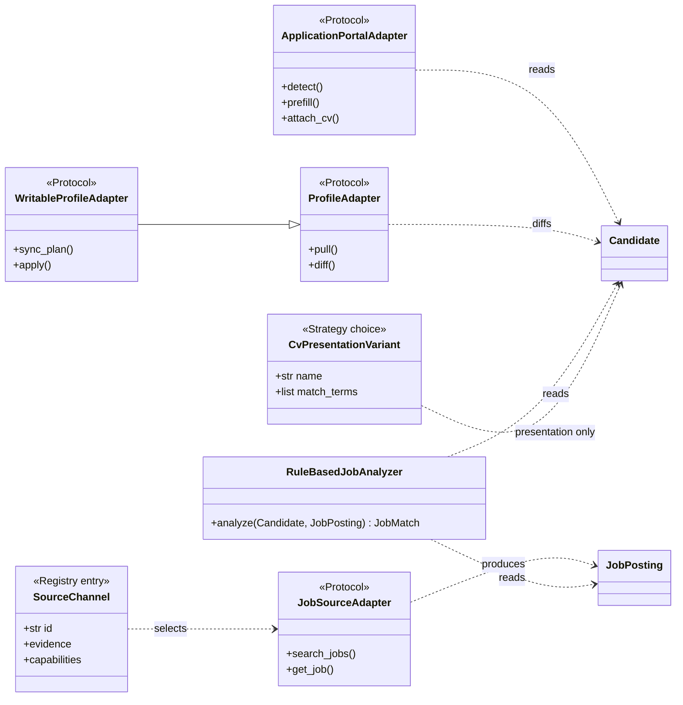

## Plan-then-apply (Command) {#plan-apply}

Patrón: **Template Method** / **Command** con dry-run default.

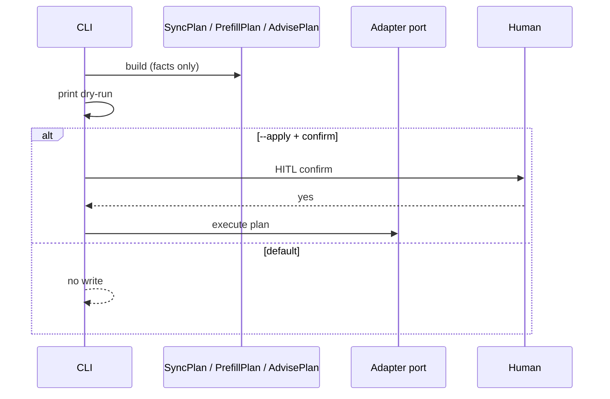

## Specification — condiciones / elegibilidad {#specification}

Patrones: **Specification**, **Result object**. Issues: #166 #186.

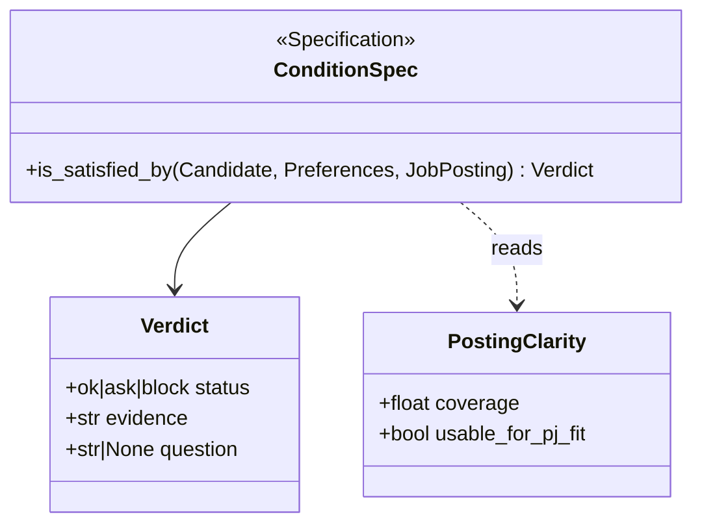

## Anti-corruption — homologación portal → perfil {#acl}

Patrón: **Anti-Corruption Layer**. Issue: #94.

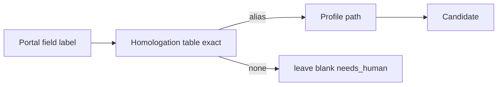

## HITL pause — desafío / CAPTCHA (sin bypass) {#hitl-pause}

Patrones: **Guard** (TTY), **Template Method** (`pause_for_manual`). Issue: #392.

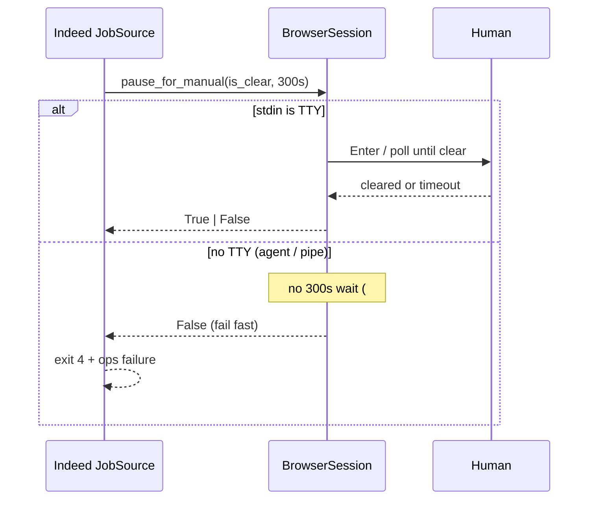

Reglas: nunca resolver CAPTCHA; nunca informar el desafío como lista vacía (#184); sin TTY no se bloquea el proceso 5 minutos.

## Search outcome — vacío ≠ falla ≠ off-topic {#search-outcome}

Patrones: **Result object**, **discriminated union**. Issues: #390 #176 #184.

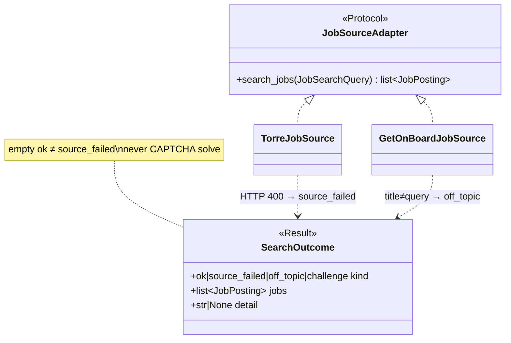

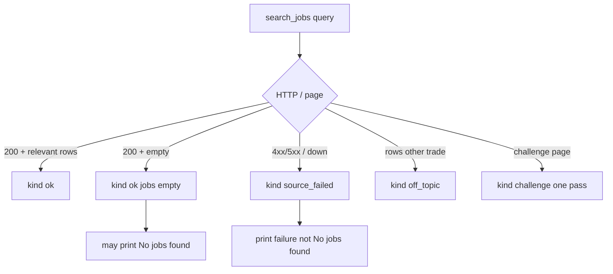

## Posting URL verify — ficha vs SERP {#posting-url-verify}

Patrones: **Specification**, **Value Object** (evidencia de URL). Issue: #388 (#182 id-only, #215 Workday).

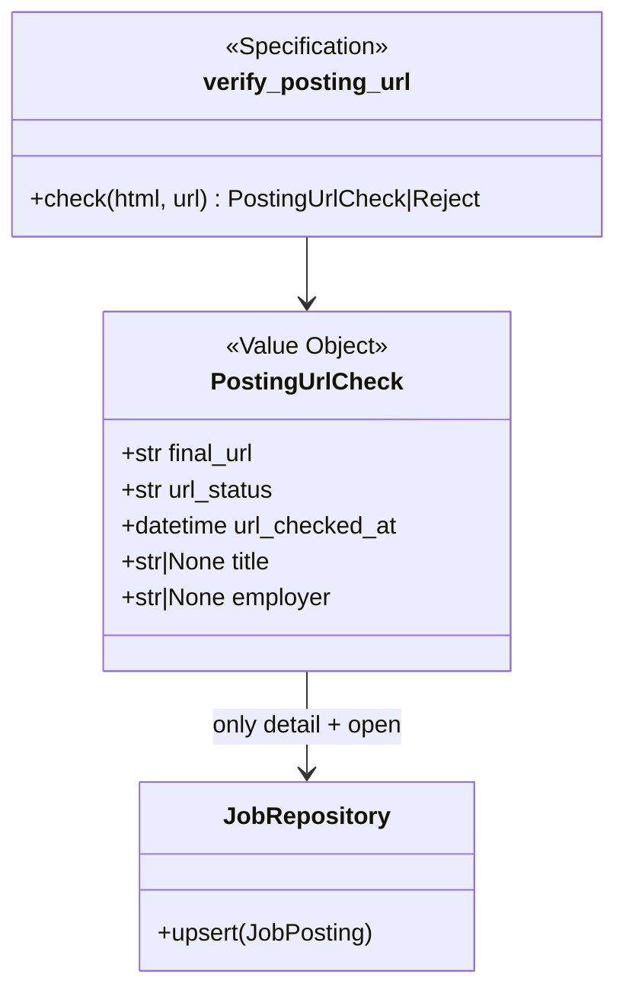

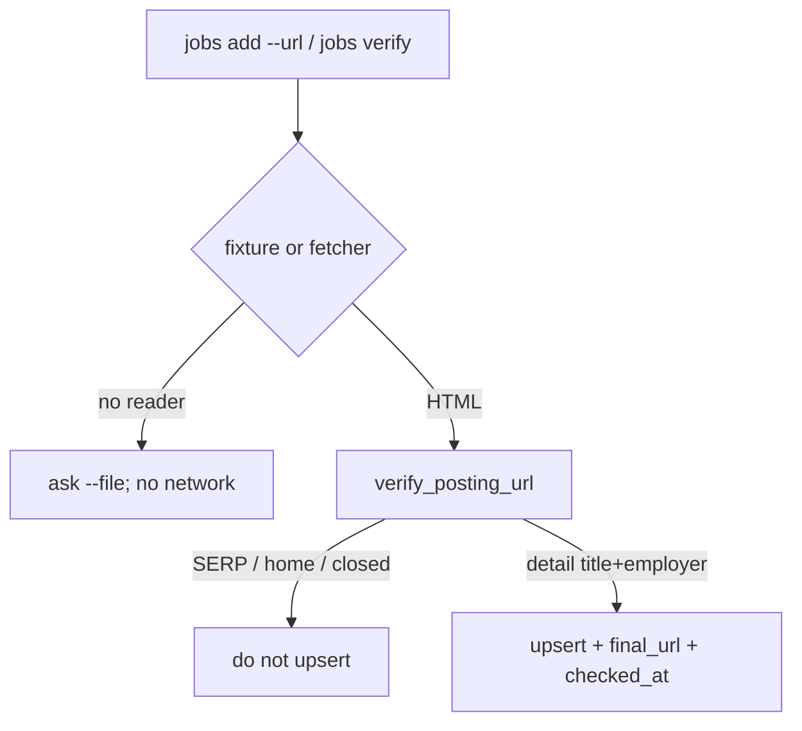

## LinkedIn details pull — sección a sección {#linkedin-details-pull}

Patrones: **ProfileAdapter** (pull), **Result** por sección. Issue: #386 (#194 snapshot vacío).

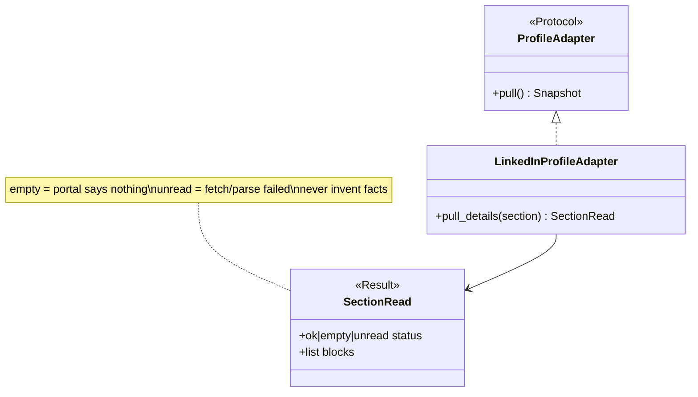

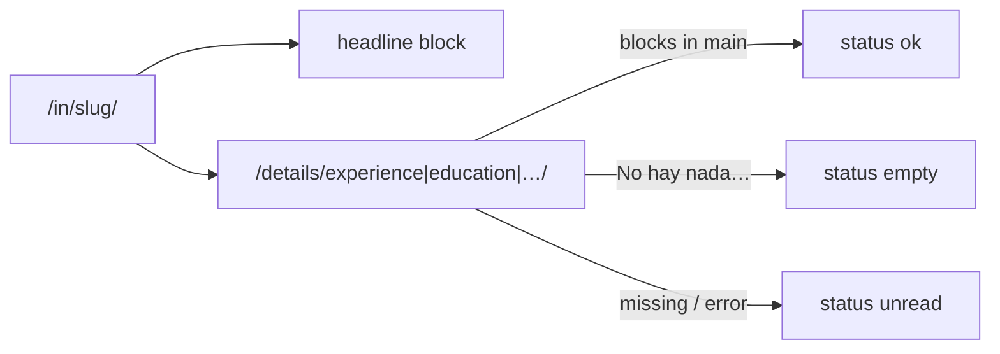

## JD LLM extract — anclado al texto {#jd-llm-extract}

Patrones: **Optional LLM** (`nlp/gateway`) + **Validator** (grounding). Issue: #384 (#85 chrome).

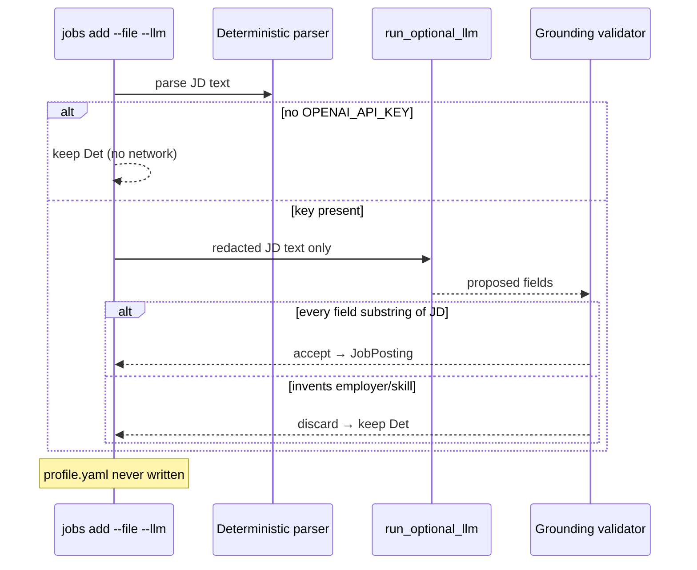

## Update mutex — un solo `jobbot update` a la vez {#update-mutex}

Patrones: **Mutex** / exclusive lock file (pid + stale reclaim). Issue: #398 (#189 dejó el lock fuera).

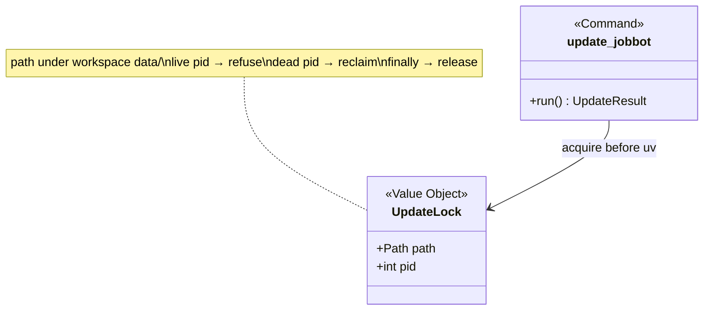

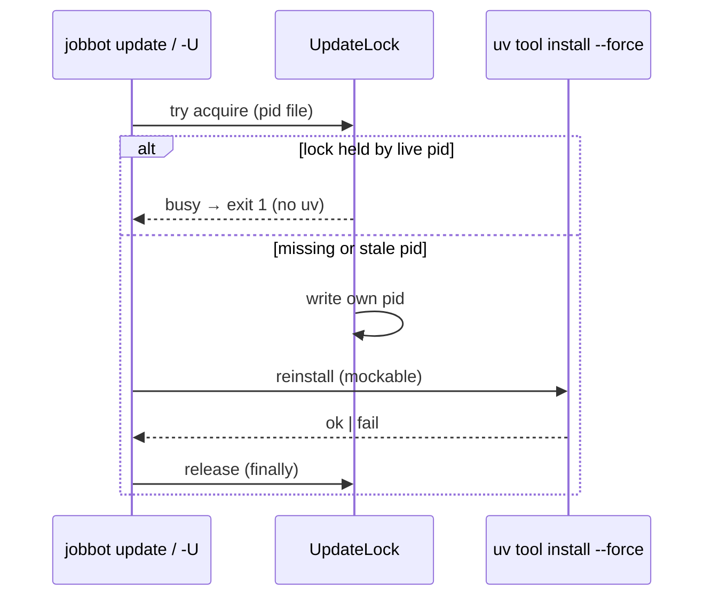

Reglas: el lock vive junto al data del workspace (no en un checkout compartido sin workspace); nunca inventar el lock en el repo; tests mockean el instalador — sin `uv` real.

## Cómo citar desde un issue

```markdown
## SDD / patrones
- SDD: docs/software-design.md §3 / §8
- Patrón(es): Value Object, Aggregate
- UML: docs/uml.md#fact-preference
- El PR actualiza el diagrama si introduce o renombra un tipo
```
