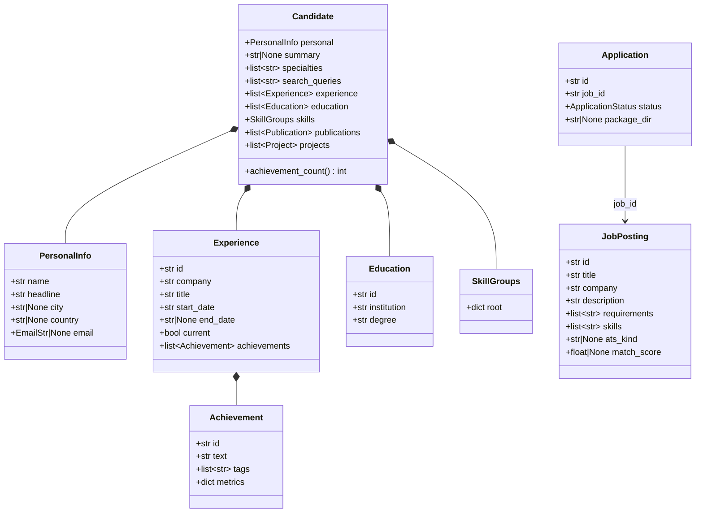
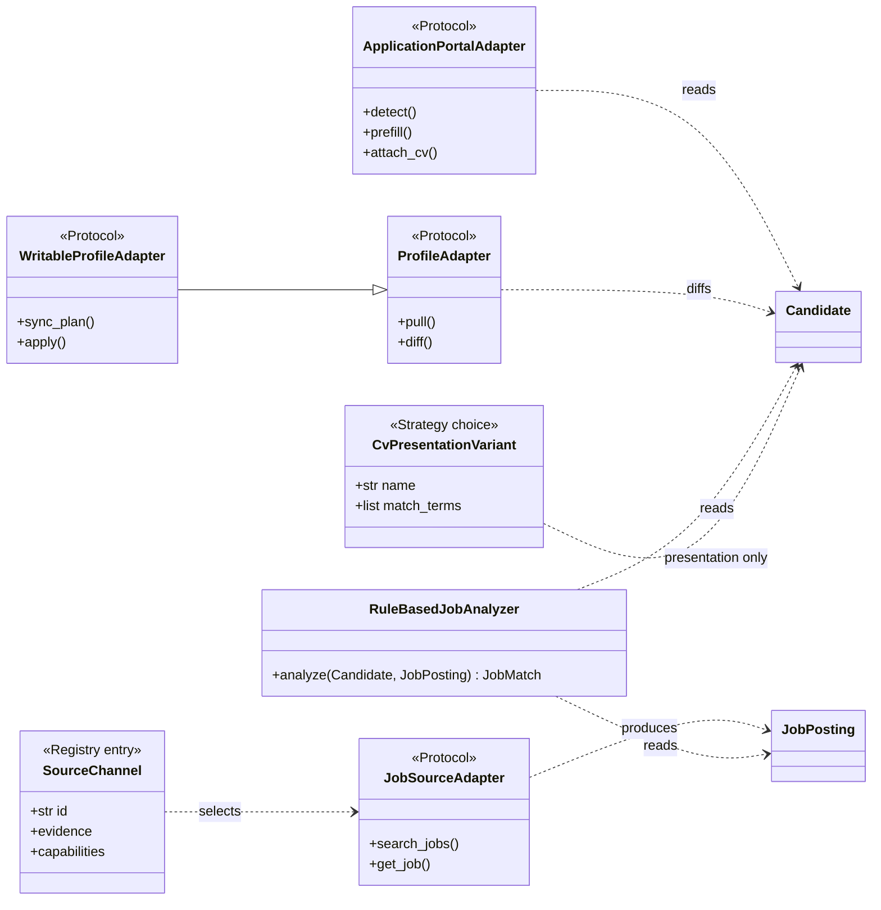
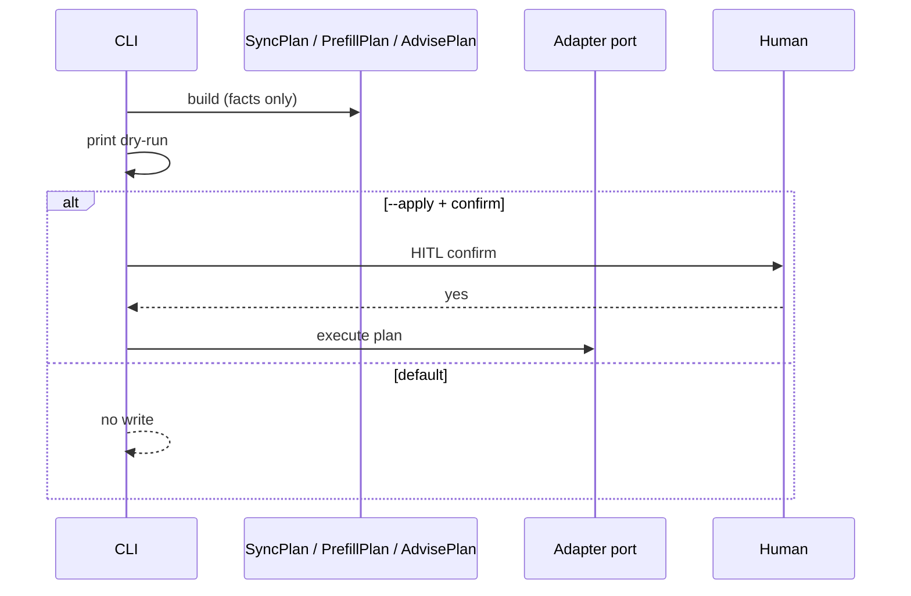
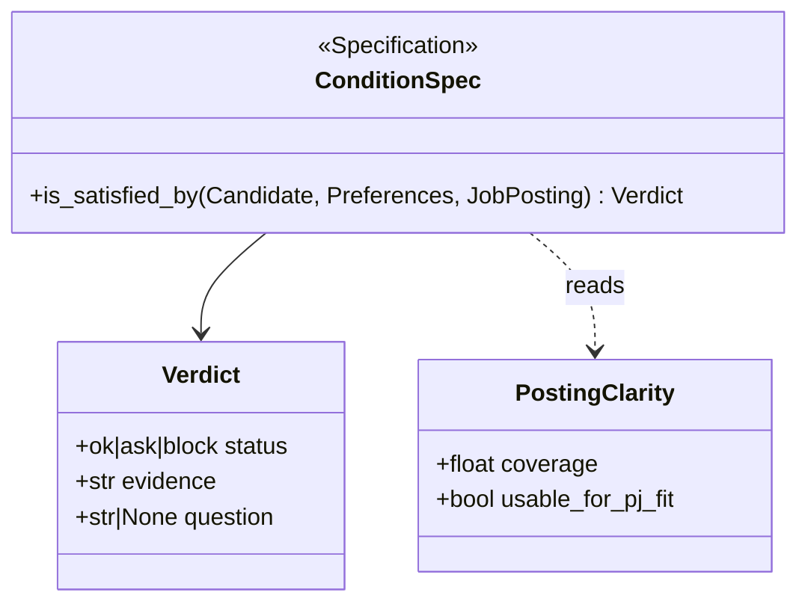
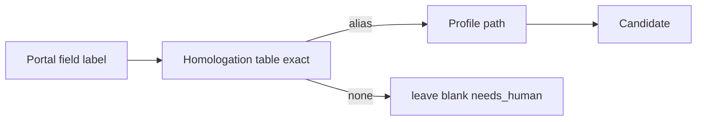

# UML — dominio y puertos

Fuente canónica de los diagramas del [software design](software-design.md).
Los PRs que añaden un tipo de dominio o un puerto **actualizan este archivo**
(o fallan el criterio de aceptación del issue).

Convención: cada diagrama tiene un ancla (`{#id}`). Los issues citan
`docs/uml.md#id`.

## Dominio actual — aggregate `Candidate` {#candidate-now}



## Target — hechos vs preferencias + evidencia {#fact-preference}

Patrones: **Aggregate Root**, **Value Object**, asociación skills↔roles.
Issues: #141 #144 #185 #195 #206 #221.


## Puertos y adapters (hexagonal) {#ports}

Patrones: **Port/Adapter**, **Factory**, **Strategy**, **Registry**.



## Plan-then-apply (Command) {#plan-apply}

Patrón: **Template Method** / **Command** con dry-run default.



## Specification — condiciones / elegibilidad {#specification}

Patrones: **Specification**, **Result object**. Issues: #166 #186.



## Anti-corruption — homologación portal → perfil {#acl}

Patrón: **Anti-Corruption Layer**. Issue: #94.



## Cómo citar desde un issue

```markdown
## SDD / patrones
- SDD: docs/software-design.md §3 / §8
- Patrón(es): Value Object, Aggregate
- UML: docs/uml.md#fact-preference
- El PR actualiza el diagrama si introduce o renombra un tipo
```
